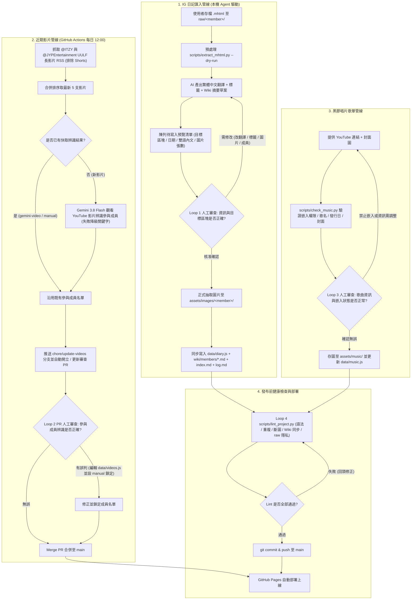

# ITZY 的日常 — Workflow & Human-in-the-Loop 架構圖

本文件定義「ITZY 的日常」三條主要資料管線（IG 日記、YouTube 近期影片、背景音樂歌單）與四大 **Human-in-the-Loop（人工審查與健康檢查迴圈）**。

## 整體 Workflow Graph

## 四大審查迴圈（Loops）總覽

| Loop | 觸發位置 | 執行工具 / 工作流 | 審查重點 |
| --- | --- | --- | --- |
| **Loop 1（已啟用）** | IG `.mhtml` 解析後、寫入網頁前 | `scripts/extract_mhtml.py --dry-run` + `AGENTS.md` SOP | 核對目標成員區塊、日期、圖片張數、韓文原文與繁中翻譯語氣、標籤 |
| **Loop 2（已啟用）** | YouTube 每日自動抓取後、合併上線前 | `.github/workflows/update-videos.yml`（自動開 PR） | 核對 `gemini-3.8-flash` 影片辨識出的參與成員；有誤改 `manual` 鎖定再 Merge |
| **Loop 3（已啟用）** | 黑膠歌單新增前 | `scripts/check_music.py` | 檢查 YouTube 影片是否允許外部嵌入（`playableInEmbed`）、歌名、發行日與封面圖 |
| **Loop 4（已啟用）** | `git push` 發布前 | `scripts/lint_project.py` | 驗證 JS 資料合法、零重複、零斷圖、`wiki/` 筆數完全一致、`raw/` 隱私零外洩 |
