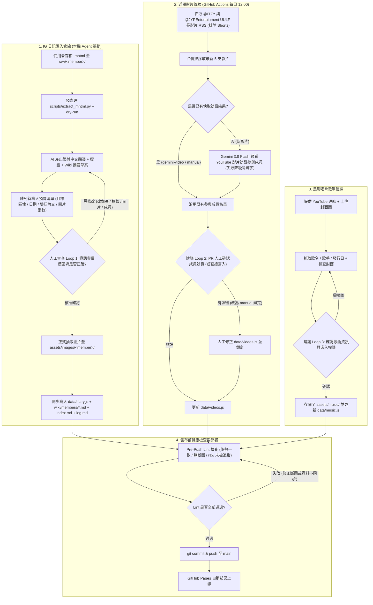

# ITZY 的日常 — Workflow & Human-in-the-Loop 架構圖

本文件定義「ITZY 的日常」三條主要資料管線（IG 日記、YouTube 近期影片、背景音樂歌單）與其中的 **Human-in-the-Loop（人工審查迴圈）** 及 **Lint 防線**。

## 整體 Workflow Graph

## 審查迴圈（Loops）對照表

| Loop | 位置 | 狀態 | 審查重點 |
| --- | --- | --- | --- |
| **Loop 1（已強制啟用）** | IG `.mhtml` 解析後、寫入網頁前 | 已寫入 `AGENTS.md` | 核對目標成員區塊、發布日期、圖片張數、韓文原文與繁體中文翻譯語氣、標籤 |
| **Loop 2（建議升級）** | YouTube 每日自動更新後、上線前 | 目前直推 `main`（可改為開 PR 審查） | 核對 `gemini-3.8-flash` 影片畫面辨識出的參與成員是否正確，有誤可改為 `manual` 鎖定 |
| **Loop 3（建議啟用）** | 音樂歌單新增前 | 輕量確認 | 核對歌名、歌手、發行日、封面裁切效果與 YouTube 影片是否允許外部嵌入 |
| **Loop 4（已內建）** | `git push` 發布前 | 已寫入 `AGENTS.md` | 確保 `raw/` 隱私檔零外洩、`data/diary.js` 與 `wiki/` 同步一致、圖片零斷鏈 |
